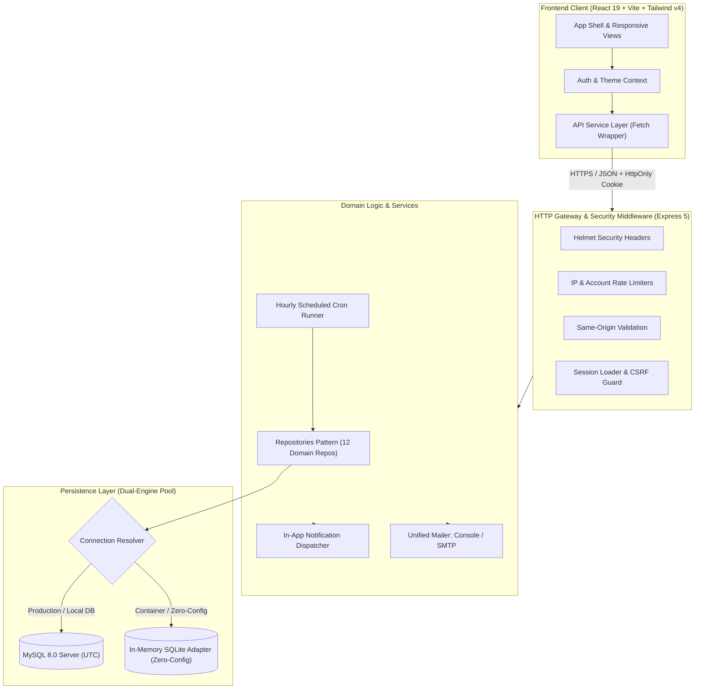
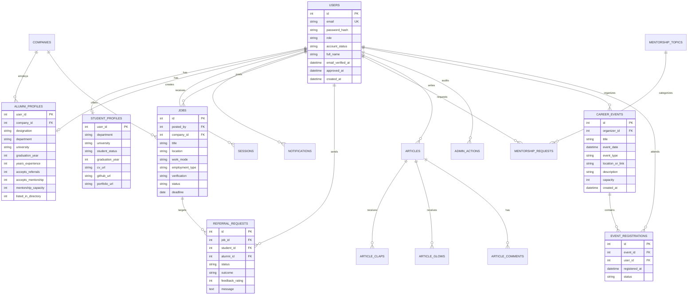
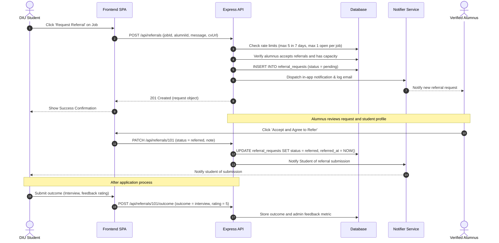
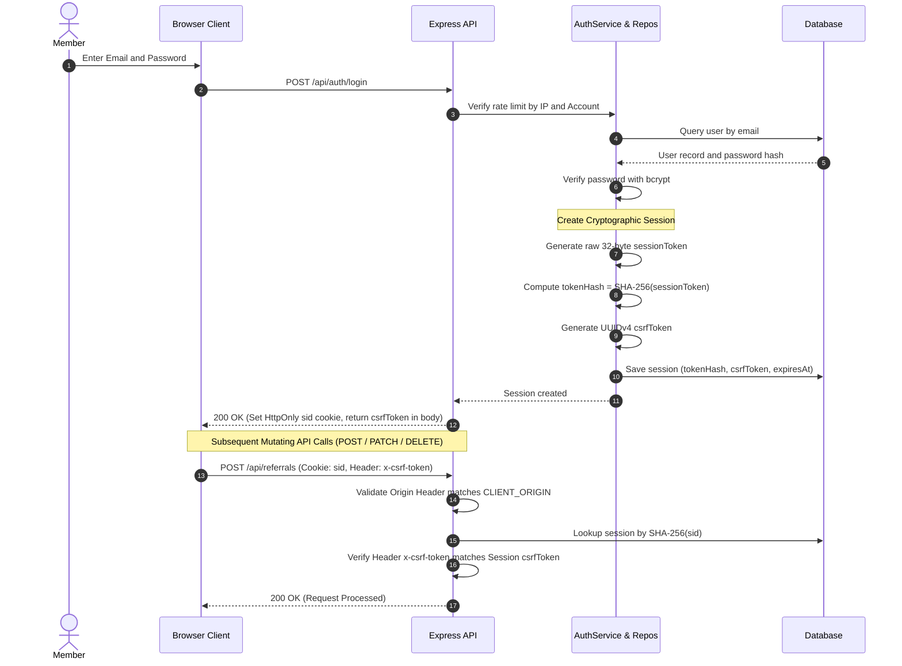
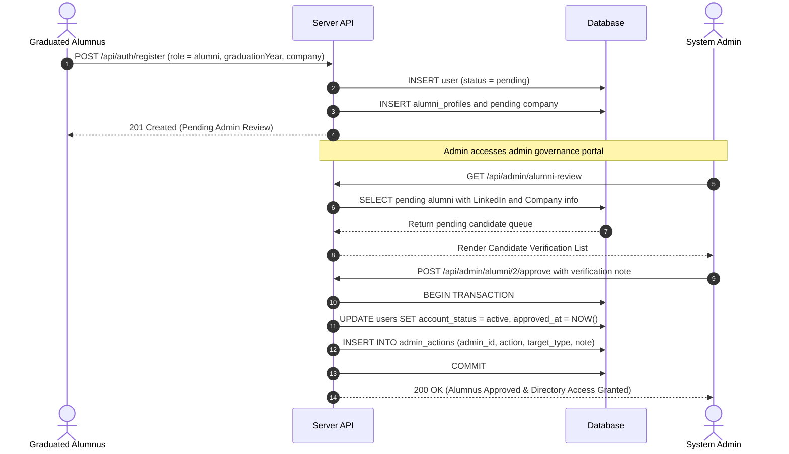
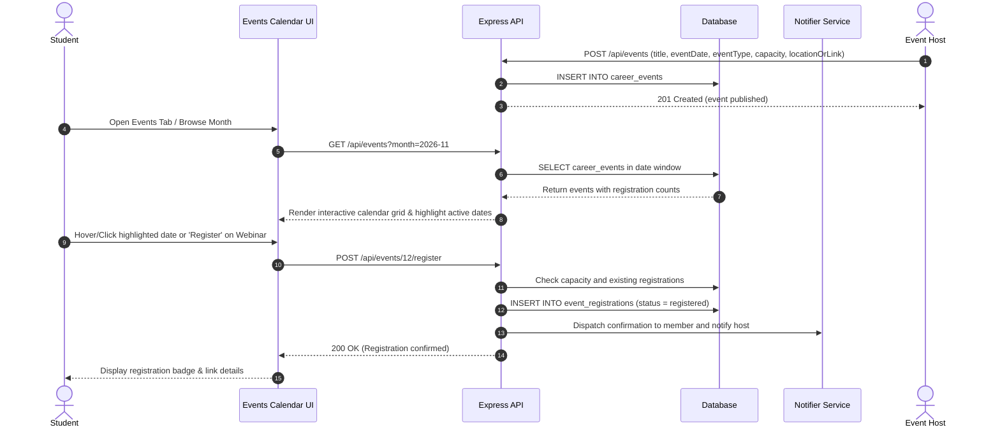

<p align="center">
  
</p>

<p align="center">
  <a href="https://nodejs.org/"></a>
  <a href="https://expressjs.com/"></a>
  <a href="https://react.dev/"></a>
  <a href="https://vite.dev/"></a>
  <a href="https://tailwindcss.com/"></a>
  <a href="https://www.mysql.com/"></a>
  <a href="https://vitest.dev/"></a>
  <a href="#license"></a>
</p>

---

# AlumniLink

> **DIU Alumni Career Connect** — An independent platform connecting Daffodil International University (DIU) students, recent graduates, and verified alumni for voluntary job referrals, 1-on-1 career mentorship, company exploration, and peer-reviewed industry insights.

> [!NOTE]
> **Independent Student Project**: AlumniLink is an independent engineering project developed by students. It is **not** officially affiliated with, endorsed by, or operated by Daffodil International University. All institutional domains and sample data used during development are for demonstration purposes.

---

## Table of Contents

- [Overview & Mission](#overview--mission)
- [System Architecture](#system-architecture)
- [End-to-End Workflows](#end-to-end-workflows)
- [Architectural Decisions (ADR Matrix)](#architectural-decisions-adr-matrix)
- [UML & Sequence Diagrams](#uml--sequence-diagrams)
  - [Domain Model & Entity Relationships (ER Diagram)](#domain-model--entity-relationships-er-diagram)
  - [Sequence Diagram 1: Job Referral Request Lifecycle](#sequence-diagram-1-job-referral-request-lifecycle)
  - [Sequence Diagram 2: Authentication & Dual-Token Session Security](#sequence-diagram-2-authentication--dual-token-session-security)
  - [Sequence Diagram 3: Alumni Verification & Governance](#sequence-diagram-3-alumni-verification--governance)
  - [Sequence Diagram 4: Career Event & Webinar Registration Lifecycle](#sequence-diagram-4-career-event--webinar-registration-lifecycle)
- [Feature Highlights](#feature-highlights)
  - [Career Events & Interactive Calendar](#career-events--interactive-calendar)
  - [Academic Department Grouping & Directory](#academic-department-grouping--directory)
  - [Institutional & University Affiliation](#institutional--university-affiliation)
- [Project Structure](#project-structure)
- [Getting Started](#getting-started)
  - [Prerequisites](#prerequisites)
  - [Local Installation](#local-installation)
  - [Database Setup & Dual-Engine Mode](#database-setup--dual-engine-mode)
  - [Environment Configuration](#environment-configuration)
- [Scripts & Tooling](#scripts--tooling)
- [Security & Privacy Posture](#security--privacy-posture)
- [License](#license)

---

## Overview & Mission

In competitive tech markets, cold applications rarely reach hiring teams. Alumni working inside technology firms, financial institutions, and multinational software houses often have access to internal referral portals, but students lack a polite, structured, and spam-free medium to connect with them.

**AlumniLink** establishes a secure, boundary-respecting ecosystem:

1. **Zero Cold-Call Spam**: Referral requests are explicitly tied to open positions with eligibility criteria.
2. **Cap-Controlled Mentorship**: Alumni define their active student capacity (1–10 students) and mentorship topics. When at capacity, the platform auto-deflects new requests.
3. **Verified Identity & Privacy**: Institutional email verification for students (`@diu.edu.bd`) and **human administrator verification** for all alumni accounts. Personal contact details (LinkedIn, email) remain strictly opt-in.
4. **Community Knowledge**: Plain-text, script-safe editorial articles sharing real interview experiences, CV advice, and tech domain roadmaps.

---

## System Architecture

AlumniLink is architected as a high-cohesion, decoupled full-stack system utilizing **npm workspaces** for monorepo ergonomics.



### Key Architectural Layers:

- **Presentation Layer**: Built on React 19 and Vite with Tailwind CSS v4, supporting dynamic dark/light theme switching, reading mode customization (Sans, Serif, Dyslexic, Comic Neue), and mobile-responsive drawers.
- **Security & Session Layer**: Enforces double-submit CSRF tokens, strict origin verification, and SHA-256 hashed session persistence over HttpOnly cookies.
- **Repository Abstraction**: All database interactions pass through decoupled domain repositories (`users`, `profiles`, `jobs`, `referrals`, `mentorship`, `articles`, `metrics`, `notifications`, etc.).
- **Dual-Engine Persistence**: Seamlessly switches between a production **MySQL 8.0** cluster and a built-in **in-memory SQLite adapter** with pre-seeded demo records for instant, zero-dependency local booting.

---

## End-to-End Workflows

```mermaid
flowchart TD
    subgraph StudentJourney ["Student Journey"]
        S1["Sign Up with @diu.edu.bd"] --> S2[Verify Email Link]
        S2 --> S3["Complete Profile: Skills, CV URL, Bio"]
        S3 --> S4[Discover Alumni & Open Jobs]
        S4 --> S5{Choose Interaction}
        S5 -->|Targeted Position| S6[Submit Referral Request]
        S5 -->|Topic Guidance| S7[Submit Mentorship Request]
        S6 --> S8[Track Status in Dashboard]
        S7 --> S8
        S8 --> S9[Report Real-world Outcome & Rate Platform]
    end

    subgraph AlumnusJourney ["Alumnus Journey"]
        A1[Alumni Registration] --> A2[Admin Review Queue]
        A2 -->|Approved| A3[Set Mentorship Topics & Capacity]
        A3 --> A4[Post Verified Jobs & Referrals]
        A3 --> A5[Review Inbound Requests]
        A5 -->|Accept| A6[Direct Contact & Referral Submission]
        A5 -->|"Decline or Report"| A7[Provide Constructive Reason]
        A3 --> A8[Publish Career Insights & Articles]
    end

    subgraph AdminGovernance ["Admin Governance"]
        AD1[Review Pending Alumni Accounts] --> AD2[Audit Company Names & Deduplicate]
        AD2 --> AD3[Review Flagged Reports & Content]
        AD3 --> AD4[Analyze Engagement Metrics & CSV Exports]
        AD4 --> AD5[Log all decisions to admin_actions]
    end
```



---

## Architectural Decisions (ADR Matrix)

The application was built following **46 documented Architecture Decision Records** (`docs/decisions.md`). Below is an executive summary of core decisions:

|  ADR #  | Decision Focus                    | Engineering Rationale & Trade-offs                                                                                                                                          |
| :-----: | :-------------------------------- | :-------------------------------------------------------------------------------------------------------------------------------------------------------------------------- |
| **#1**  | **Brand Identity & Independence** | Named _AlumniLink_. Operates as an independent student initiative with zero institutional copyright infringements or official logos.                                        |
| **#3**  | **Manual Alumni Verification**    | Institutional emails never prove alumni graduation status. Every alumnus account requires human admin vetting before unlocking member features.                             |
| **#7**  | **Stack Choice**                  | React 19 + Express 5 + MySQL 8 + Tailwind CSS v4. Replaced bloated ORMs with parameterised raw SQL queries for transparency and performance.                                |
| **#10** | **Link-Only CV Policy**           | Zero PDF/DOCX file uploads stored on the application server. Students provide secure external links (Google Drive, portfolio), preventing security and storage liabilities. |
| **#11** | **Privacy-First Directory**       | Alumnus contact details (LinkedIn, email) are hidden by default. Students submit in-app requests; alumni choose what contact details to return.                             |
| **#17** | **UTC Clock Discipline**          | All sessions and databases run strictly in UTC (`SET time_zone = '+00:00'`) to avoid daylight saving and timezone drift.                                                    |
| **#24** | **Calculated Job Expiration**     | Jobs expire automatically based on Bangladesh calendar days or 60 days post-creation. No cron dependency required for basic visibility filtering.                           |
| **#28** | **Request Throttle Limits**       | Max 1 open referral request per student per job, and max 5 requests per 7-day window. Prevents spamming busy alumni.                                                        |
| **#32** | **Mentorship Capacity Limits**    | Alumni set a concurrent student cap (1–10). Once filled with pending/accepted requests, the system automatically marks the mentor "At Capacity".                            |
| **#38** | **Safe Markdown Engine**          | Articles support safe markdown subsets (`##`, `-`, `**`, links) rendered purely with React element ASTs without `dangerouslySetInnerHTML`.                                  |
| **#45** | **14-Day Auto-Expiration**        | Stale pending requests auto-expire after 14 days, releasing mentor capacity slots and notifying the student to contact alternative mentors.                                 |

---

## UML & Sequence Diagrams

### Domain Model & Entity Relationships (ER Diagram)



---

### Sequence Diagram 1: Job Referral Request Lifecycle



---

### Sequence Diagram 2: Authentication & Dual-Token Session Security



---

### Sequence Diagram 3: Alumni Verification & Governance



---

### Sequence Diagram 4: Career Event & Webinar Registration Lifecycle



---

## Feature Highlights

| Module             | Features & Capabilities                                                                                                                                                                         |
| :----------------- | :---------------------------------------------------------------------------------------------------------------------------------------------------------------------------------------------- |
| **Referrals**      | Job-tied requests, pre-screening confirmation, automatic 14-day expiry, outcome tracking (Interview / Offer / No Interview), satisfaction feedback.                                             |
| **Mentorship**     | 6 standardized topics (CV review, interview prep, career transitions, QA, backend, etc.), capacity limits (1–10), auto-deflection when busy.                                                    |
| **Directory**      | Fast multi-criteria filter (Role, Company, Department, Graduation Year, Mentorship Availability), **Academic Department Grouping** with quick-jump nav, and University/Institution affiliation. |
| **Career Events**  | Interactive monthly calendar with date indicators & tooltips, event registration, upcoming webinar list with 1-click 'Register', event creation for alumni/admin.                               |
| **Jobs Board**     | Verification tags (_Verified_ vs _Shared by alumni_), auto-expiration on deadline, work mode indicators (Remote, Hybrid, Onsite), direct application links.                                     |
| **Community**      | Collapsible topic channels with "See more / See less" (6-item default), bi-directional topic carousel with matching left/right arrow controls, reading font switcher, claps & glows.            |
| **Administration** | Alumni vetting queue, company moderation, flagged report resolutions, bulk invite engine (up to 200 at once), real-time CSV metrics download.                                                   |

### Career Events & Interactive Calendar

AlumniLink includes a career events and webinar management system designed to connect students with alumni-hosted tech talks, resume teardowns, mock interviews, and industry webinars:

- **Month-by-Month Calendar Navigation**: Full calendar grid with previous/next month controls and a 'Today' shortcut button.
- **Event Highlights & Tooltips**: Calendar days featuring events are accented with notification badges; hovering over dates displays event titles, times, and organizers.
- **Active Day Schedule Inspector**: Clicking any day reveals the detailed agenda and registration links directly beneath the calendar.
- **Upcoming Events List**: Compact home-page widget showcasing upcoming webinars with a one-click **Register** button and real-time attendee counts.
- **Event Creation Engine**: Verified alumni and administrators can schedule webinars with capacity limits, event types (`webinar`, `workshop`, `networking`, `career_fair`), and join links.

### Academic Department Grouping & Directory

The Alumni Directory (`/alumni`) provides multiple view modes to help students discover graduates from their own discipline:

- **Group by Academic Department Dropdown**: A dropdown filter allows users to switch between the default flat grid and a grouped departmental breakdown (`?groupBy=department`).
- **Department Sections**: Organizes alumni under distinct department banners (e.g., _Computer Science and Engineering (CSE)_, _Software Engineering (SWE)_, _Electrical and Electronic Engineering (EEE)_, _Computing and Information System (CIS)_) complete with an alumnus headcount badge.
- **Quick-Jump Navigation**: An in-page department navigation ribbon allows users to quickly jump down to any department section without scrolling through hundreds of entries.
- **Synchronized URL Filters**: All filters—including department grouping, search queries, company, and mentorship flags—are serialized into URL search parameters for link sharing and bookmarking.

### Institutional & University Affiliation

Profiles and directory cards support university affiliation tracking:

- **Multi-University Support**: While tailored for Daffodil International University (DIU), the platform supports alumni and students from other academic institutions with standard auto-suggestions and custom inputs.
- **Profile & Card Display**: Member profiles and directory cards feature institutional labels alongside academic department and graduation year.

### Custom Usernames & Live Availability Checker

Members can claim and customize their unique `@username` handle for direct profile identification, mentions, and links:

- **Live Debounced Availability Check**: While typing, the client checks availability in real-time (`GET /api/profile/username-check`) with visual cues for Available (green), Taken (rose), Current (neutral), or Invalid format states.
- **Strict Format & Safety Validation**: Usernames enforce 3–30 characters, alphanumeric characters with hyphens and underscores (`/^[a-z0-9][a-z0-9_-]{1,28}[a-z0-9]$/`), and protect reserved system terms.
- **Multi-Location Management**: Users can edit and update their username directly from **Account Settings** (`/account/settings`) or the **Edit Profile** screen (`/account/profile`).
- **Instant Global Synchronization**: Updating a username automatically refreshes across the active session, header avatar menu, and profile pages.

---

### Messages, Privacy & Account Controls

- **Direct messages**: one message until the other person replies, ten new conversations a day, with Sent, Delivered and Seen.
- **Safety**: members can block each other across the site and report a message; admins read only the reported message.
- **Privacy settings**: last seen (exact, day only or hidden), read receipts, directory listing, profile picture visibility and who can read each post.
- **Student directory**: students and recent graduates, filterable by status, department and what they are looking for.
- **Career status**: open to work, looking for internship, hiring or open to new roles, with a reminder after 90 days.
- **Leaving**: deactivate for a chosen time, or delete with 15 days to change your mind.
- **Founding Members**: the first 100 verified members are numbered.

## Project Structure

```
alumnilink-diu/
├── client/                     # Frontend SPA (React 19, Tailwind CSS v4)
│   ├── public/                 # Static assets & SVG icons
│   ├── src/
│   │   ├── components/         # Reusable atomic UI (Layout, Events Calendar, Badges, Cards, Shell)
│   │   ├── lib/                # API client, Auth Context, Theme, Helpers
│   │   ├── pages/              # Routed pages (Home, Jobs, Directory, Mentorship, Events)
│   │   │   ├── admin/          # Governance & Audit log pages
│   │   │   ├── auth/           # Login, Registration, Password Reset flows
│   │   │   ├── directory/      # Alumni & Company directory (Grouped & Filtered)
│   │   │   ├── jobs/           # Job posting, listing, and detail views
│   │   │   ├── mentorship/     # Mentorship request and management
│   │   │   ├── referrals/      # Referral request pipeline
│   │   │   └── resources/      # Community Insights & article publishing
│   │   ├── App.jsx             # Route definitions & guards
│   │   └── main.jsx            # React root mount
│   ├── index.html              # HTML shell with accessibility metadata
│   └── vite.config.js          # Vite build config & proxy
│
├── server/                     # Backend API (Node.js 22, Express 5)
│   ├── db/
│   │   ├── migrations/         # 29 Sequential SQL migrations (Events, University, Profiles)
│   │   ├── setup/              # One-time database and limited user script
│   │   └── migrate.js          # Zero-dependency migration engine
│   ├── scripts/                # Admin generation & demo data seeders
│   ├── src/
│   │   ├── auth/               # Password hashing, email templates, sessions
│   │   ├── config/             # Zod-validated environment config
│   │   ├── db/                 # MySQL pool & In-memory SQLite adapter
│   │   ├── jobs/               # Hourly background cron scheduler
│   │   ├── middleware/         # Security headers, rate limiting, error handling
│   │   ├── repositories/       # 13 Database access repositories (Events, Directory, Jobs, etc.)
│   │   ├── routes/             # REST API routers (/api/* including events and directory)
│   │   ├── services/           # Mailer, Notifier, and Metrics aggregators
│   │   ├── app.js              # Express app factory
│   │   └── server.js           # Server entry point
│   ├── tests/                  # Unit and mock repository tests
│   └── tests-db/               # Integration tests against live database
│
├── docs/                       # Project Documentation & Architecture Records
│   ├── auth-design.md          # Cryptographic session & CSRF architecture
│   ├── concept-note.md         # Original product concept & requirements
│   ├── decisions.md            # 46 Architecture Decision Records (ADRs)
│   ├── deployment.md           # Production server & Nginx configuration
│   └── security-review.md      # Pre-pilot security audit findings
│
├── alumnilink-banner.svg       # Animated SVG hero asset
├── metadata.json               # Platform manifest & capabilities
└── package.json                # Monorepo workspaces definition
```

---

## Getting Started

### Prerequisites

- **Node.js**: `v20.19.0` or higher (Node 22 recommended)
- **Package Manager**: `npm` (v10+)
- **Database**: MySQL 8.0 (Optional — the app includes an automatic SQLite fallback for zero-config startup)

---

### Local Installation

1. **Clone the repository**:

   ```bash
   git clone https://github.com/Likhons/AlumniLink-DIU.git
   cd AlumniLink-DIU
   ```

2. **Install all dependencies** (installs both client and server via npm workspaces):
   ```bash
   npm install
   ```

---

### Database Setup & Dual-Engine Mode

The application supports **two database engines**:

#### Option A: Zero-Config In-Memory Mode (Default for Preview & Rapid Testing)

If no `DB_PASSWORD` is configured in `server/.env`, AlumniLink **automatically boots in zero-config mode** using an internal SQLite adapter pre-seeded with rich demo alumni, jobs, mentorship requests, and community articles.

#### Option B: Real MySQL 8.0 Server (Recommended for Full Parity)

1. Initialize the databases and restricted application user:
   ```bash
   mysql -u root -p < server/db/setup/create-database.sql
   ```
2. Run database migrations:
   ```bash
   npm run db:migrate
   ```
3. Seed demo data:
   ```bash
   npm run db:seed-demo
   ```

---

### Environment Configuration

Copy the example environment configuration:

```bash
cp .env.example server/.env
```

Review the values in `server/.env`:

```ini
NODE_ENV=development
PORT=3000
CLIENT_ORIGIN=http://localhost:3000

# Database Configuration (Leave empty to use automatic in-memory SQLite adapter)
DB_HOST=localhost
DB_PORT=3306
DB_USER=alumnilink_app
DB_PASSWORD=your_secure_password
DB_NAME=alumnilink_diu

# Institutional Email Domains (Comma-separated)
ALLOWED_STUDENT_EMAIL_DOMAINS=diu.edu.bd,daffodilvarsity.edu.bd

# Email Dispatcher (Leave unset in dev to output emails to console)
SMTP_HOST=
SMTP_PORT=587
SMTP_USER=
SMTP_PASSWORD=
MAIL_FROM=AlumniLink <no-reply@localhost>
```

---

### Starting the Application

Run the dev command from the root directory:

```bash
npm run dev
```

- **Application URL**: `http://localhost:3000`
- **Health Check API**: `http://localhost:3000/api/health`

---

## Scripts & Tooling

All lifecycle scripts are managed via npm workspaces from the project root:

| Command                   | Description                                                              |
| :------------------------ | :----------------------------------------------------------------------- |
| `npm run dev`             | Builds the client SPA and launches the Express server on port 3000.      |
| `npm run build`           | Builds the React frontend client with Vite for production.               |
| `npm test`                | Runs fast backend unit tests (uses in-memory stubs; no DB needed).       |
| `npm run test:db`         | Runs comprehensive integration test suite against `alumnilink_diu_test`. |
| `npm run lint`            | Lints JavaScript and JSX files using ESLint.                             |
| `npm run format`          | Auto-formats codebase using Prettier.                                    |
| `npm run db:migrate`      | Executes all pending SQL migration files in sequence.                    |
| `npm run db:status`       | Shows status of all applied vs pending database migrations.              |
| `npm run admin:create`    | Creates a super-admin account with a one-time temporary password.        |
| `npm run db:seed-demo`    | Seeds or resets demo alumni, students, jobs, and articles.               |
| `npm run jobs:run`        | Manually triggers the hourly background maintenance scheduler.           |
| `npm run users:usernames` | Gives accounts created before usernames existed a unique `@username`.    |

---

## Security & Privacy Posture

AlumniLink was audited under a pre-pilot security review (`docs/security-review.md`):

1. **CSRF Immunity**: Dual-token architecture. Session ID stored in an `HttpOnly`, `SameSite=Lax` cookie; state-changing requests require a synchronized `x-csrf-token` header.
2. **Brute Force & Rate Limiting**: Dual-layer rate limiters on `/api/auth/login` (by IP and by target account email) to defend against credential stuffing.
3. **Parameterised SQL**: All queries execute with `?` bind variables; zero string concatenation ensures total resistance to SQL Injection.
4. **Link-Only Artifacts**: Students submit CV links (Google Drive, Dropbox) rather than uploading files, preventing malware execution and hosting liability.
5. **PII Shielding**: Alumnus email and LinkedIn accounts are strictly hidden unless explicitly permitted by the alumnus.
6. **XSS Protection**: Community articles render plain text and curated Markdown constructs (`##`, `-`, `**`) via native React elements with zero `innerHTML` usage.

---

## License

This project is licensed under the **MIT License**. See the [LICENSE](LICENSE) file for full details.

```
Copyright (c) 2026 AlumniLink Contributors

Permission is hereby granted, free of charge, to any person obtaining a copy
of this software and associated documentation files (the "Software"), to deal
in the Software without restriction, including without limitation the rights
to use, copy, modify, merge, publish, distribute, sublicense, and/or sell
copies of the Software, and to permit persons to whom the Software is
furnished to do so, subject to the following conditions:

The above copyright notice and this permission notice shall be included in all
copies or substantial portions of the Software.
```

---

<p align="center">
  <b>AlumniLink</b> · Built with care by students for the DIU community.
</p>
